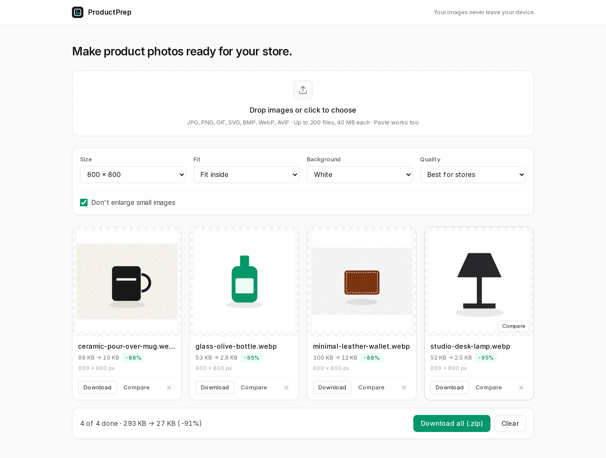
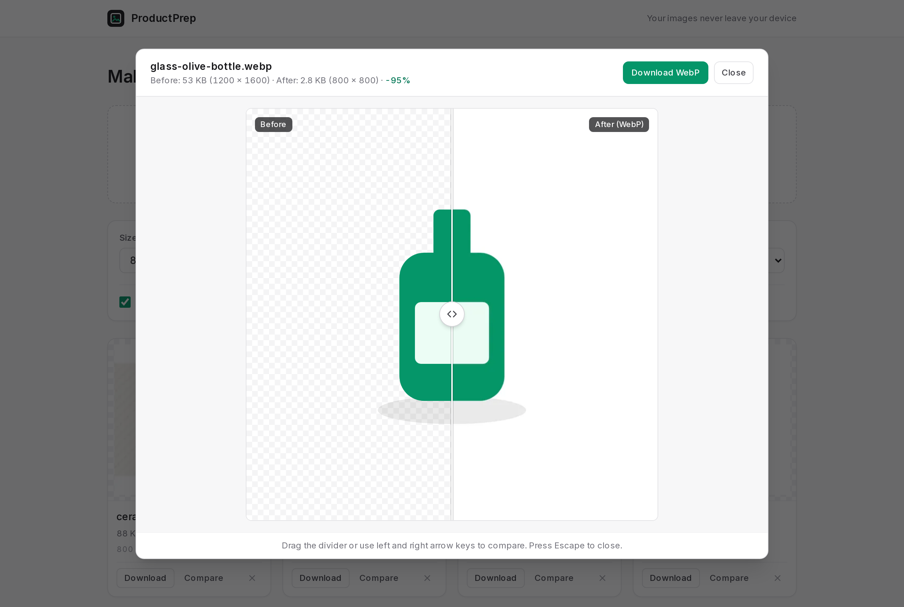

# ProductPrep

A free, fast web tool that turns inconsistent product photos into clean, store-ready WebP images right in your browser. Drop one photo or a whole catalog to resize without stretching, strip metadata, compare before and after, and download everything as a single zip.

## Screenshots





## Features

- **Never stretches photos:** Fit inside with padding (`800 × 800`, `1000 × 1000`, `1200 × 1200`, `2000 × 2000`, custom `Width × Height` with an optional square lock, or keep original dimensions) or centre-crop to fill.
- **No accidental upscaling:** Small images stay sharp and centred on the canvas when "Don't enlarge small images" is on (vectors always rasterise cleanly at target size).
- **Clean backgrounds:** Fill padding and transparent images with white, a custom colour, or keep transparency intact.
- **Store-ready WebP compression:** Encoded with Google's `libwebp` compiled to WebAssembly (`Best for stores`, `Smaller files`, bit-exact `Lossless`, `Target size` binary search with a quality floor, or `Custom (%)` from `95%` down to `10%`).
- **Phone photos stay upright & private:** EXIF orientation is respected before resizing, and all EXIF, XMP, and ICC metadata is stripped from outputs.
- **Bulk processing & streaming zip:** Runs across a pool of Web Workers so the tab stays responsive, with before/after inspection, per-image downloads, clean Unicode-safe filenames, and instant streaming `.zip` export.
- **Keyboard & clipboard friendly:** Paste images straight from the clipboard and control settings, cards, and the before/after slider from the keyboard.

## Supported formats

| Direction | Formats | Notes |
| --- | --- | --- |
| **Input** | JPG / JPEG, PNG, GIF, SVG, BMP, WebP, AVIF | Detected by file signature (magic bytes), not file extension |
| **Output** | WebP | Encoded via WebAssembly `libwebp` for consistent quality across browsers |

Format details:

- **Animated GIF / WebP:** Uses the first frame and displays a clear notice on the card.
- **SVG:** Rasterised safely via a sandboxed `` path on the main thread (scripts never execute) at the exact target size; SVGs without `width`, `height`, or `viewBox` show a clear error.
- **16-bit PNG & CMYK JPEG:** Decoded natively by modern browsers; unsupported fallback cases show a clear one-line message instead of failing silently.

## How it works

```text
file -> detect magic bytes + check header dimensions (<= 40 MB, <= 50 MP)
     -> decode (browser decoder; WASM / pure-TS fallback; SVG on main thread)
     -> apply EXIF orientation once (never double-rotated)
     -> resize with Lanczos3 in linear light (@jsquash/resize)
     -> composite on raw RGBA buffers (fit / crop, background or alpha)
     -> encode WebP (@jsquash/webp, quality presets / lossless / target search)
     -> strip metadata + slugify/dedupe filename -> streaming STORE zip (fflate)
```

Images are processed off the main thread in a pool of `max(1, min(4, hardwareConcurrency - 1))` Web Workers using zero-copy `ArrayBuffer` transfers. Codecs load lazily inside the worker on first use, cards render compact `<= 320 px` thumbnails, and object URLs are revoked as soon as previews or batches close.

## Privacy

Everything runs locally in your browser. Your photos are never uploaded to a server, never stored remotely, and no accounts or cookies are required. Only your output preferences are saved in `localStorage`.

## Run locally

Requires **Node.js 24 LTS** (or 22.22+).

```bash
npm install
npm run dev
```

Build and preview the static production site:

```bash
npm run build
npm run preview
```

Run checks and tests:

```bash
npm run check       # Svelte + TypeScript checks
npm run lint        # Prettier + ESLint
npm test            # Unit and component tests (Vitest)
npm run test:e2e    # End-to-end browser tests (Playwright; run after build)
```

## Deploy to Cloudflare Pages

ProductPrep builds to plain static files (`@sveltejs/adapter-static`), so it deploys anywhere static sites are hosted:

1. Connect the repository in Cloudflare Pages.
2. Set **Build command** to `npm run build`.
3. Set **Build output directory** to `build`.
4. Set environment variable `NODE_VERSION` to `24`.

No server runtime, environment secrets, or database are required.

## Limits

- **Batch size:** Up to 200 files per batch.
- **File size:** Up to 40 MB per file.
- **Resolution:** Up to 50 megapixels per image (checked from file headers before decoding).

## License

MIT — see [LICENSE](LICENSE). Self-hosted [Inter 4.0](static/fonts/OFL.txt) is licensed under the SIL Open Font License 1.1.
